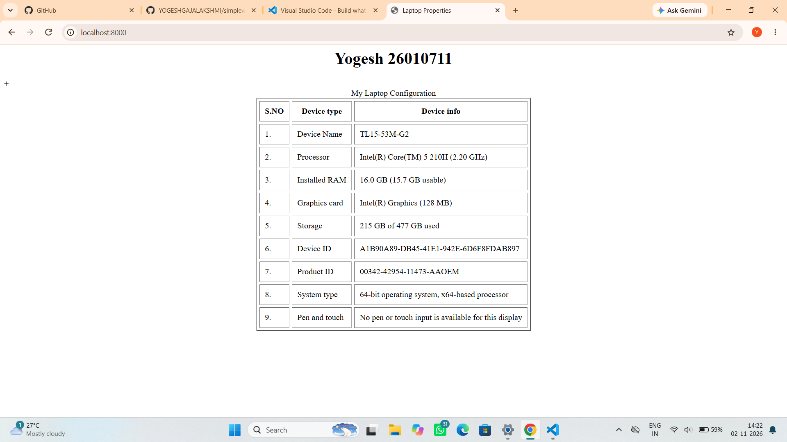

# EX01 Developing a Simple Webserver
## Date:

## AIM:
To develop a simple webserver to serve html pages and display the Windows Specifications of your Laptop.

## DESIGN STEPS:
### Step 1: 
HTML content creation.

### Step 2:
Design of webserver workflow.

### Step 3:
Implementation using Python code.

### Step 4:
Import the necessary modules.

### Step 5:
Define a custom request handler.

### Step 6:
Start an HTTP server on a specific port.

### Step 7:
Run the Python script to serve web pages.

### Step 8:
Serve the HTML pages.

### Step 9:
Start the server script and check for errors.

### Step 10:
Open a browser and navigate to http://127.0.0.1:8000 (or the assigned port).

## PROGRAM:
### Python Code

```python
from http.server import HTTPServer, SimpleHTTPRequestHandler

class MyHandler(SimpleHTTPRequestHandler):
    pass

server = HTTPServer(("127.0.0.1", 8000), MyHandler)

print("Web Server Started Successfully")
print("Open http://127.0.0.1:8000")

server.serve_forever()
```


### HTML Code


```html
<!DOCTYPE html>
<html>
<head>
    <title>Laptop Properties</title>
</head>
<body>
    <center>
        <h1>Yogesh 26010711</h1>
        <table border="1" cellpadding="12" cellspacing="5">
            <caption>My Laptop Configuration</caption>
            <tr>
                <th>S.NO</th>
                <th>Device type</th>
                <th>Device info</th>
            </tr>
            <tr>
                <td>1.</td>
                <td>Device Name</td>
                <td>TL15-53M-G2</td>
            </tr>
            <tr>
                <td>2.</td>
                <td>Processor</td>
                <td>Intel Core 5 210H</td>
            </tr>
            <tr>
                <td>3.</td>
                <td>Installed RAM</td>
                <td>16 GB</td>
            </tr>
            <tr>
                <td>4.</td>
                <td>Graphics Card</td>
                <td>Intel Graphics</td>
            </tr>
            <tr>
                <td>5.</td>
                <td>Storage</td>
                <td>477 GB</td>
            </tr>
            <tr>
                <td>6.</td>
                <td>System Type</td>
                <td>64-bit operating system</td>
            </tr>
        </table>
    </center>
</body>
</html>
```


## OUTPUT:




## RESULT:
The program for implementing simple webserver is executed successfully.
